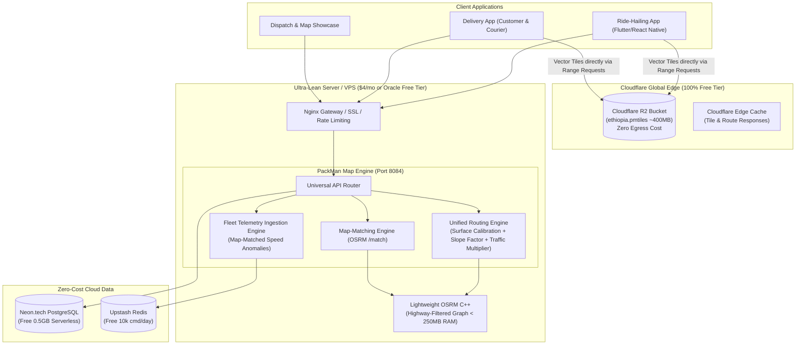

# Unified Ethiopian Map Platform — Production Master Roadmap
### Universal Spatial Authority for Ride-Hailing, Delivery & Logistics
**Target Markets**: Addis Ababa & Gondar (Nationwide Ready)  
**Budget Target**: Ultra-Lean ($0 to $5/month)  
**Infrastructure**: Cloudflare R2 (Vector Tiles) + 1 Lightweight Highway-Filtered OSRM (< 250MB RAM) + Serverless Neon/Upstash + Node.js DDD API  

---

## 1. Architectural Principle: Pure Spatial Authority

Following the **Single Responsibility Principle**, the Map Service acts strictly as a **neutral, high-precision spatial and routing authority** (identical to how Google Maps or Mapbox operate).

It does **not** hardcode app-specific business logic (e.g. no artificial `serviceType: "ride"` or `serviceType: "delivery"` branches). Instead, it outputs **ground-truth physical facts**:
* Exact road-snapped distance ($m$).
* Realistic transit duration ($s$) calibrated for vehicle physics, surface types (*chigign* vs asphalt), slope grades, and traffic.
* Road surface composition breakdown (% asphalt, % cobblestone, % unpaved).
* Detailed turn-by-turn navigation steps and polyline geometry.

Both your **Ride-Hailing App** and your **Delivery App** hit the exact same universal endpoints and apply their own domain rules:
* **Ride-Hailing Backend**: Multiplies `distance.meters` and `duration.seconds` by per-km and per-minute rates for fare metering; uses duration for passenger pickup/dropoff ETAs.
* **Delivery Backend**: Uses `distance.meters` for delivery fee tiers; adds its own kitchen prep and customer handover buffers (+4m) inside the delivery backend where business logic belongs.

---

## 2. Ultra-Lean Infrastructure Architecture ($0 – $5/mo)



---

## 3. Phased Implementation Tracker

### Phase 1: Ultra-Lean Data Pipeline & Unified OSRM Engine (Days 1–2)
*Goal: Compile a lightweight nationwide road graph running under 250MB RAM with all small roads and cobblestones preserved.*

| ID | Task | Deliverable / File | Status |
|---|---|---|:---:|
| **1.1** | **Highway-Only PBF Filter** | `scripts/filter-roads.sh`: Uses `osmium tags-filter` on `ethiopia-latest.osm.pbf` keeping `w/highway`. Strips trees/fences; preserves all cobblestone (*chigign*), residential, and alley roads. Shrinks file from 130MB to ~25MB. | `[ ] Pending` |
| **1.2** | **Unified Surface & Vehicle Lua Profile** | `docker/profiles/ethiopia-unified.lua`: Single profile supporting cars, motorcycles, bajaj, and pedestrians with realistic surface speeds (*chigign* 18 km/h, dirt 12 km/h, asphalt 45 km/h). | `[ ] Pending` |
| **1.3** | **Pre-Compiled Graph Volume Mount** | `scripts/compile-graph.sh`: Compiles graph offline once; container startup time drops to $< 3\text{ seconds}$. | `[ ] Pending` |
| **1.4** | **RAM Footprint Hardening** | Verify OSRM runs with `--algorithm mld` consuming $< 250\text{ MB RAM}$. | `[ ] Pending` |

---

### Phase 2: Serverless $0 Tile Infrastructure via PMTiles (Days 3–4)
*Goal: Zero tile load on your VPS, zero OSM IP ban risks, crisp vector styling.*

| ID | Task | Deliverable / File | Status |
|---|---|---|:---:|
| **2.1** | **Generate `ethiopia.pmtiles`** | Compile vector tiles from PBF using `planetiler` (zooms 0 to 15, ~400MB total). | `[ ] Pending` |
| **2.2** | **Upload to Cloudflare R2** | Set up R2 bucket with custom domain (e.g. `tiles.yourdomain.et`) with public read access ($0 egress). | `[ ] Pending` |
| **2.3** | **MapLibre Style Generator** | Update `TileController.serveStyle()` to serve MapLibre JSON styles (`dark.json`, `light.json`, `street.json`) pointing to the R2 PMTiles source. | `[ ] Pending` |
| **2.4** | **Fallback Raster Tile Proxy Cache** | `TileController.serve()`: Disk cache in `data/tiles/` with 30-day TTL for legacy raster clients. | `[ ] Pending` |

---

### Phase 3: Universal Routing Engine with Surface & Incline Physics (Days 5–6)
*Goal: High-precision routing and ground-truth ETA across all vehicle classes.*

| ID | Task | Deliverable / File | Status |
|---|---|---|:---:|
| **3.1** | **Add `BAJAJ` Profile** | `src/domain/value-objects/profile.vo.ts`: Add `RouteProfile.BAJAJ` across domain models, use cases, and DTOs. | `[ ] Pending` |
| **3.2** | **Surface & Slope Post-Processor** | `src/domain/services/routing/eta-enhancer.ts`: Enriches raw OSRM steps with surface speed caps (*chigign* 18 km/h) and uphill grade penalties ($>8\%$ grade $\rightarrow 1.4\times$). | `[ ] Pending` |
| **3.3** | **Surface Composition Breakdown** | `src/domain/entities/route.entity.ts`: Computes road composition (% asphalt, % cobblestone, % unpaved) in route summaries. | `[ ] Pending` |
| **3.4** | **City Geofence Rules** | `src/domain/services/routing/city-guard.ts`: Warn/block Bajaj requests on Addis Ababa expressways; allow unrestricted in Gondar. | `[ ] Pending` |

---

### Phase 4: Dynamic & Live Traffic Ingestion Engine (Days 7–8)
*Goal: Zero-cost traffic updates from day 1 using hybrid time-of-day + fleet telemetry.*

| ID | Task | Deliverable / File | Status |
|---|---|---|:---:|
| **4.1** | **Time-of-Day Traffic Matrices (Day 1)** | `src/domain/services/traffic/rush-hour-matrix.ts`: Built-in speed dampening for Addis (Gotera, Meskel Sq, Megenagna) and Gondar (Arada Saturday market). | `[ ] Pending` |
| **4.2** | **Fleet Telemetry Ingestion Endpoint** | `POST /api/v1/map/traffic/telemetry`: Batch ingest driver GPS points (`lat`, `lng`, `speed`, `heading`, `profile`). | `[ ] Pending` |
| **4.3** | **Redis Traffic Cache & TTL** | Store segment speed anomalies in Redis with 10-minute sliding window; update `TrafficSegment` table. | `[ ] Pending` |
| **4.4** | **Live Traffic Route Adjustment** | `PlanRouteUseCase`: Query Redis segment speeds to adjust step durations dynamically. | `[ ] Pending` |

---

### Phase 5: Map-Matching & Driver Tracking (Day 9)
*Goal: Smooth passenger map experience and accurate deviation alerts.*

| ID | Task | Deliverable / File | Status |
|---|---|---|:---:|
| **5.1** | **Snap-to-Roads API** | `POST /api/v1/map/match`: Map-matches noisy raw GPS traces onto OSM road lines using OSRM's `/match` API. | `[ ] Pending` |
| **5.2** | **Driver Bearing & Heading Interpolation** | Computes smooth vehicle rotation angles for passenger and dispatch tracking UI. | `[ ] Pending` |
| **5.3** | **Deviation Checks** | `CheckDeviationUseCase`: Detects when an active driver deviates $> 80\text{m}$ from the planned route. | `[ ] Pending` |

---

### Phase 6: Production Hardening & Testing (Days 10–11)
*Goal: 100% test coverage for critical paths, rate limiting, and zero-crash guarantee.*

| ID | Task | Deliverable / File | Status |
|---|---|---|:---:|
| **6.1** | **Rate Limiting & Security** | Redis rate limiter: 60 req/min for route, 300 req/min for telemetry, 600 req/min for tiles. Whitelist CORS. | `[ ] Pending` |
| **6.2** | **Vitest Test Suite** | Unit tests for Bajaj speed clamping, cobblestone slowdowns, hill grade factors, and traffic speed multipliers. | `[ ] Pending` |
| **6.3** | **Real-World Corridor Benchmarks** | Benchmark test suite against 5 corridors in Addis Ababa and 5 in Gondar. | `[ ] Pending` |

---

## 4. Universal API Request/Response Contracts

### A. Universal Route Planning (`POST /api/v1/map/route`)

#### Request:
```json
{
  "profile": "bajaj",
  "origin": { "lat": 12.6078, "lng": 37.4697, "name": "Arada Post Office" },
  "destination": { "lat": 12.6180, "lng": 37.4580, "name": "Kebele 18 Residential" }
}
```
*(Valid profiles: `"driving"`, `"bajaj"`, `"motorcycle"`, `"walking"`, `"cycling"`)*

#### Response (Universal Ground-Truth Facts):
```json
{
  "summary": {
    "distance": {
      "meters": 1840,
      "text": "1.8 km"
    },
    "duration": {
      "seconds": 390,
      "text": "6.5 mins"
    },
    "metered": {
      "distanceKm": 1.84,
      "durationMinutes": 6.5
    }
  },
  "traffic": {
    "congestionLevel": "normal",
    "delaySeconds": 0
  },
  "roadDetails": {
    "asphaltPercent": 40,
    "cobblestonePercent": 60,
    "unpavedPercent": 0,
    "inclineGradeAvg": 6.2
  },
  "geometry": {
    "type": "LineString",
    "coordinates": [
      [37.4697, 12.6078],
      [37.4685, 12.6092],
      [37.4580, 12.6180]
    ]
  }
}
```

---

### B. Driver Telemetry Ingestion (`POST /api/v1/map/traffic/telemetry`)

```json
{
  "driverId": "driver_8821",
  "profile": "driving",
  "pings": [
    { "lat": 9.0112, "lng": 38.7620, "speedKmh": 14.2, "bearing": 182, "timestamp": 1732442400 },
    { "lat": 9.0105, "lng": 38.7612, "speedKmh": 11.5, "bearing": 180, "timestamp": 1732442410 }
  ]
}
```
*Backend matches pings to road segments and updates live speed averages in Redis and `TrafficSegment`.*

---

### C. Snap-to-Roads / Map Matching (`POST /api/v1/map/match`)

```json
{
  "profile": "driving",
  "coordinates": [
    [38.7615, 9.0102],
    [38.7613, 9.0109],
    [38.7612, 9.0115]
  ],
  "timestamps": [1732442400, 1732442405, 1732442410]
}
```
*Returns smoothed, snapped coordinates pinned directly to the road centerline with interpolated bearing angles.*

---

## 5. Ground-Truth Calibration Corridors

### Addis Ababa
1. **Airport Artery**: Bole Airport $(8.9806, 38.7578) \rightarrow$ Kazanchis $(9.0195, 38.7710)$
2. **Peak Hour Bottleneck**: Meskel Square $(9.0108, 38.7615) \rightarrow$ Megenagna $(9.0210, 38.8020)$
3. **Outer Condominium Corridor**: CMC Michael $(9.0270, 38.8350) \rightarrow$ Ayat Zone 5 $(9.0350, 38.8650)$

### Gondar
1. **Highway Connector**: Azezo Bridge $(12.5350, 37.4380) \rightarrow$ Piassa $(12.6078, 37.4697)$
2. **Cobblestone Neighborhood**: Arada $(12.6105, 37.4650) \rightarrow$ Kebele 18 $(12.6180, 37.4580)$
3. **Steep Incline Corridor**: Posta Bet $(12.6080, 37.4680) \rightarrow$ Goha Hotel $(12.6145, 37.4815)$
